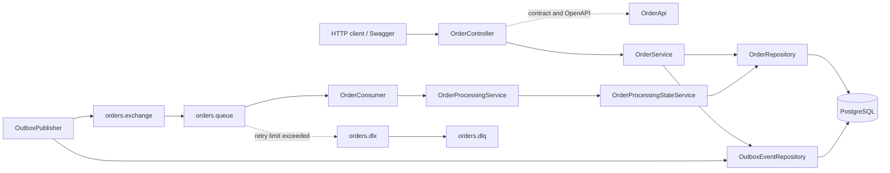

# Arquitetura

O escopo desta etapa contém o backend e suas dependências. O frontend Angular será conectado depois.

`OrderApi` documenta o contrato HTTP com OpenAPI. `OrderController` é a implementação e concentra os mapeamentos das rotas. Serviços coordenam os casos de uso; repositories persistem entidades. O pacote `messaging` separa `producer`, `consumer` e `dto`; a topologia RabbitMQ permanece em `config`. `OrderMapper` usa MapStruct para converter entidades e DTOs da API, mantendo cálculos e regras de negócio nas entidades.

## Camadas

| Pacote | Responsabilidade |
|---|---|
| `controller` | Rotas REST e contrato documentado |
| `service` | Criação, consulta e transições de processamento |
| `repository` | Acesso a pedidos e eventos Outbox |
| `model.entity` / `model.enums` | Entidades JPA e enums do domínio, separados por tipo |
| `dto.request` / `dto.response` | Contratos HTTP |
| `messaging.producer` / `messaging.consumer` / `messaging.dto` | Publicação e reserva Outbox; consumo, retry e recuperação; contrato de mensagem RabbitMQ |
| `mapper` | Conversão entre entidades e DTOs com MapStruct |
| `exception` | Erros HTTP padronizados |
| `config` | Configuração centralizada de Jackson, RabbitMQ, OpenAPI/Swagger e agendamento |

Erros usam `ProblemDetail` do Spring, compatível com RFC 9457. `fieldErrors` e `timestamp` são extensões documentadas para a API.
