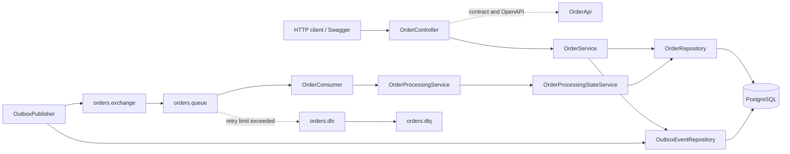

# Arquitetura

O escopo desta etapa contém o backend e suas dependências. O frontend Angular será conectado depois.

`OrderApi` documenta o contrato HTTP com OpenAPI. `OrderController` é a implementação e concentra os mapeamentos das rotas. Serviços coordenam os casos de uso; repositories persistem entidades; o pacote `messaging` contém publicação, consumer e recuperação de mensagens, enquanto a topologia RabbitMQ fica centralizada em `config`.

## Camadas

| Pacote | Responsabilidade |
|---|---|
| `controller` | Rotas REST e contrato documentado |
| `service` | Criação, consulta e transições de processamento |
| `repository` | Acesso a pedidos e eventos Outbox |
| `model` | Entidades persistidas e status |
| `dto` | Contratos HTTP e mensagem RabbitMQ |
| `messaging` | Topologia, publicação Outbox, consumo, retry e DLQ |
| `exception` | Erros HTTP padronizados |
| `config` | Configurações centralizadas de RabbitMQ, OpenAPI/Swagger e agendamento |

Erros usam `ProblemDetail` do Spring, compatível com RFC 9457. `fieldErrors` e `timestamp` são extensões documentadas para a API.
