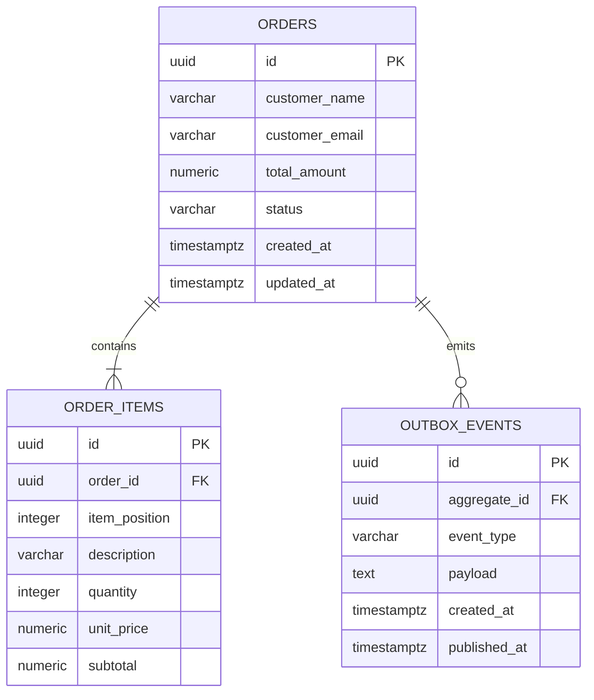

# Modelo de dados

O schema é criado por `src/main/resources/db/migration/V1__create_order_tables.sql`. Valores monetários usam `NUMERIC(19,2)`. `item_position` preserva a ordem dos itens enviada na criação. `published_at IS NULL` identifica eventos ainda pendentes na Outbox.
