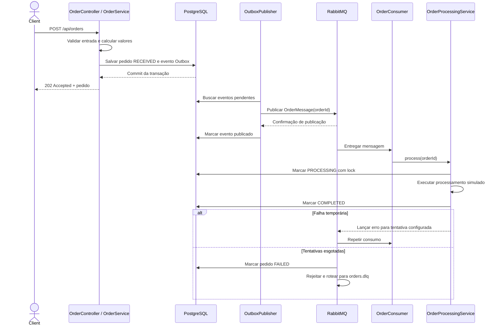

# Fluxo de processamento

A requisição HTTP não espera pelo processamento. O evento Outbox é persistido junto com o pedido para evitar a janela de perda entre o commit do banco e a publicação. O reenvio após uma falha de confirmação pode duplicar a mensagem; o consumer ignora pedidos finalizados ou já reivindicados recentemente.
